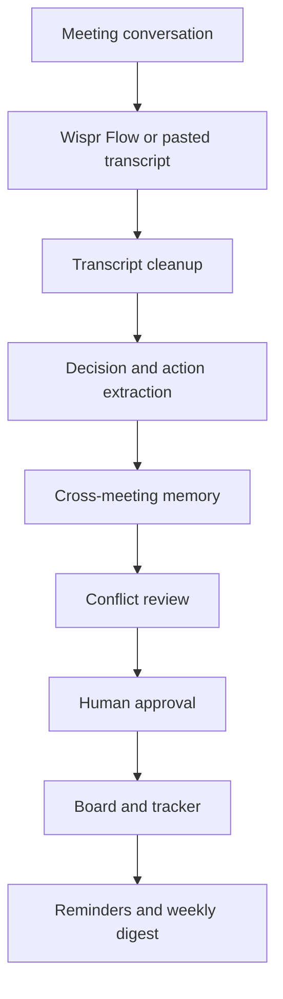

# 🚀 Vaaniमंथन
### From Conversations to Decisions. From Decisions to Action.

**Vaaniमंथन** is a voice-first meeting intelligence and execution workspace. It turns dictated or pasted meeting conversations into reviewable decisions, cross-meeting conflicts, action items, reminders, and person-specific digests.

Built for the **Product Space AI Hackathon in collaboration with Wispr Flow**, Vaaniमंथन explores how voice-first interaction can help teams move from discussion to accountable action.

## The problem

Meetings create decisions and commitments, but important details are easy to lose. Owners and dates may be unclear, priorities can change, and a decision made today may conflict with one from an earlier meeting. A summary alone does not show what changed or what needs to happen next.

## The solution

Vaaniमंथन keeps meeting outcomes in an evolving, reviewable workspace. It cleans dictated text, extracts decisions and action items, compares new decisions with cross-meeting memory, and puts people in control before tasks are published.

### Features

- **Voice-first capture:** dictate with Wispr Flow or paste a speaker-labelled transcript.
- **Transcript review:** compare raw input with the cleaned, speaker-attributed transcript.
- **Decision memory:** compare new decisions with earlier meeting decisions and flag reversals, deadline changes, scope changes, and resource conflicts.
- **Self-correction tracking:** preserve spoken corrections such as “Thursday, no wait, Friday” with a visible diff.
- **Action items:** review task, owner, due date, completion criteria, evidence, and missing information.
- **Human approval:** approve, edit, or reject every item before publishing it to a tracker.
- **Board and digest:** track commitments, view weekly digests, and inspect in-app notifications.
- **Ready demo:** open the seeded walkthrough without an LLM key to see the pricing reversal, mobile release conflict, self-correction, and action items. **Load demo dictation** inserts the sample into Speak; processing dictated text requires an LLM provider key.

## Walkthrough

1. **Speak:** dictate through Wispr Flow, paste a transcript, or open the ready demo.
2. **Review:** inspect raw and cleaned text, resolve conflicts, and approve or edit action items.
3. **Board:** view commitments, run the reminder time simulator, and open a weekly digest.



## Technology

| Area | Implementation |
|---|---|
| Backend | Python, FastAPI, Pydantic v2 |
| Database | SQLite through SQLAlchemy and a repository layer |
| Frontend | React, Vite, Tailwind CSS |
| LLM routing | Groq, then optional Gemini and OpenRouter providers |
| Decision similarity | Gemini embeddings when configured, otherwise TF-IDF cosine similarity |
| Reminders | APScheduler with an in-app notification feed |
| Task publishing | Mock tracker by default, with Trello and GitHub options |

## Run locally on Windows

Requirements: Python 3.10 or newer, Node.js 20 or newer, and npm.

From the project root in PowerShell:

```powershell
python -m venv .venv
.\.venv\Scripts\Activate.ps1
python -m pip install -r backend\requirements.txt
Copy-Item .env.example .env
```

For live extraction and conflict classification, add your provider keys to the project-root `.env` file (copy `.env.example` first). Groq is tried first; Gemini and OpenRouter are optional fallbacks. To configure Gemini, set `GEMINI_API_KEY` and `GEMINI_MODEL`; Gemini embeddings are also used for decision memory when `GEMINI_EMBED_MODEL` is configured. Keep these keys in `.env` on your machine and never commit or paste them into chat. Restart the backend after changing `.env`. Keep `TRACKER=mock` for a safe demo. For Trello, set `TRELLO_KEY`, `TRELLO_TOKEN`, and `TRELLO_LIST_ID`. For GitHub, set `GITHUB_TOKEN` and `GITHUB_REPO` (`owner/repository`).

Start the backend from the project root:

```powershell
uvicorn app.main:app --app-dir backend --reload --port 8000
```

In a second PowerShell window:

```powershell
cd frontend
npm ci
npm run dev
```

Open the Vite URL (normally `http://localhost:5173`). FastAPI runs at `http://localhost:8000`; its interactive API docs are at `/docs`.

The first backend startup seeds two historical meetings. The ready demo adds a third seeded meeting once and is safe to open repeatedly. Local SQLite data is stored in `vaanimanthan.db` in the project root and is excluded from Git.

## Deploy the full app on Vercel

The root `vercel.json` deploys the Vite frontend and FastAPI backend as two services, routes `/api/*` to FastAPI, and schedules the protected reminder endpoint every minute. Vercel Functions do not provide durable local SQLite storage, so set `DATABASE_URL` to a managed PostgreSQL connection string in the Vercel project settings. The backend converts standard `postgres://` or `postgresql://` URLs to SQLAlchemy's asyncpg driver. Set `CRON_SECRET` to a long random value and add `GROQ_API_KEY`, `GROQ_LLM_MODEL`, `GEMINI_API_KEY`, `GEMINI_MODEL`, and `GEMINI_EMBED_MODEL` in Vercel's Environment Variables. Never commit these values.

Vercel Cron schedules that run every minute require Pro or Enterprise. Hobby projects are limited to one cron run per day, which is too infrequent for the T-24h/T-2h reminders. Keep the local APScheduler for development; Vercel uses the authenticated `/api/cron/reminders` function instead. Connect the GitHub repository to Vercel or deploy from the project root with the Vercel CLI after linking the project.

## Tests

From the project root:

```powershell
python -m pytest backend\tests
```

The tests cover extraction schema validity, conflict detection against seeded meeting memory, and the publish approval gate.

## Hackathon context

**Event:** Product Space AI Hackathon  
**In collaboration with:** Wispr Flow

Vaaniमंथन is a hackathon prototype. The ready demo uses deterministic seeded content; processing a new dictated transcript uses the configured LLM provider. External tracker publishing remains behind explicit item approval.

**Vaaniमंथन — because a meeting should end with clarity, ownership, and action.**

#AIHackathon #WisprFlow #ProductSpace #AIAgents #MeetingIntelligence #VoiceAI
